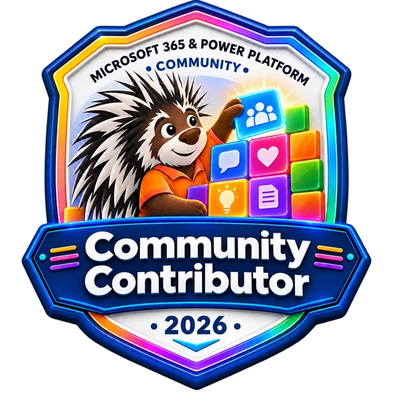

# Contribution Guidance

Share agents, plugins, and extensibility samples for Microsoft 365 Copilot, built with tools such as Visual Studio Code, Microsoft 365 Agents Toolkit, and Microsoft Copilot Studio.

If you'd like to contribute to this repository, please read the following guidelines. Contributors are more than welcome to share their learnings with others in this centralized location.

For a quick walkthrough, see the gallery's [getting started](https://pnp.github.io/copilot-pro-dev-samples/getting-started/) and [contributing](https://pnp.github.io/copilot-pro-dev-samples/contributing/) pages. Sample authors are recognized in the [contributor directory](https://pnp.github.io/copilot-pro-dev-samples/contributors/) using the authors recorded in each sample's `assets/sample.json`.

You do not need a new sample to contribute. Improvements to documentation, accessibility, screenshots, issue reports, and reviews are welcome too. Keep those changes separate from new sample submissions.

## Gallery and documentation changes

The Astro gallery lives in [`site/`](./site). Keep gallery-only improvements separate from new sample submissions. Follow the [site development guide](./site/README.md) to generate the catalog, type-check, build, and run regression tests, including the GitHub Pages base path.

Sample metadata and READMEs are the source of truth; do not edit the generated `site/public/samples.json` by hand. Keep author accounts, thumbnail order, screenshots, and update dates accurate so gallery cards, the contributor directory, and What's new stay current.

The site adds its own route-specific view tracker to every page, including sample details. Keep the required tracker in each sample-root README as well; the site removes that embedded tracker when rendering documentation to avoid duplicate page counts.

## Community calls and demos

Join our [weekly community calls](https://aka.ms/community/calls) for Copilot, Microsoft 365, and Power Platform updates. Everyone is welcome. If you would like to share your learnings or gather community input, [sign up for a demo](https://aka.ms/community/request/demo).

New to open source? Join a free [Sharing is Caring session](https://pnp.github.io/sharing-is-caring/) for help with GitHub and the contribution process.

## Community recognition

Your work helps other developers learn, prototype, and build. Keep the contributors in your sample README and `assets/sample.json` accurate so the community can acknowledge their work.

[](https://aka.ms/community/recognition)

[Learn about community recognition](https://aka.ms/community/recognition), including available badges and how to request recognition for your contributions.

## Code of Conduct

This project has adopted the [Microsoft Open Source Code of Conduct](https://opensource.microsoft.com/codeofconduct/).
For more information, see the [Code of Conduct FAQ](https://opensource.microsoft.com/codeofconduct/faq/) or contact [opencode@microsoft.com](mailto:opencode@microsoft.com) with any additional questions or comments.

Remember that this repository is maintained by community members who volunteer their time to help. Be courteous and patient.

## Question or Problem?

For a question, bug, or enhancement related to a sample or this gallery, [open an issue](https://github.com/pnp/copilot-pro-dev-samples/issues/new). Include the sample folder, reproduction steps, expected and actual behavior, and relevant toolchain versions. For general platform questions, start with the [Microsoft 365 Copilot documentation](https://learn.microsoft.com/microsoft-365-copilot/extensibility/) and [community resources](https://aka.ms/community/home). See the [support guidelines](./SUPPORT.md); samples are provided as is.

## Typos, Issues, Bugs and contributions

Whenever you are submitting any changes to repositories in the PnP organization, please follow these recommendations.

* Always fork the repository to your own account before making your modifications
* Do not combine multiple changes to one pull request. For example, submit any samples and documentation updates using separate PRs
* If your pull request shows merge conflicts, make sure to update your local main to be a mirror of what's in the main repo before making your modifications
* If you are submitting multiple samples, please create a specific PR for each of them
* If you are submitting typo or documentation fix, you can combine modifications to single PR where suitable

## Sample Naming and Structure Guidelines

When you submit a new sample, please follow these guidelines:

* Each sample must be placed in a folder under the `samples` folder
* Your sample folder must include the following content:
  * Your solution's source code
  * An `assets` folder containing `sample.json` and at least one screenshot
  * A sample-root `README.md` file
* You must only submit samples for which you have the rights to share. Make sure that you asked for permission from your employer and/or clients before committing the code to an open-source repository, because once you submit a pull request, the information is public and _cannot be removed_.

### Sample Folder

* Use the prefix for your sample type, followed by a short, descriptive name
* Use lowercase letters, digits, and hyphens; do not use spaces, underscores, or periods

### README.md

* You will need to have a `README.md` file for your contribution. Use a project-specific template when one is available, or follow the required structure below. Your `README.md` must be named exactly `README.md` -- with capital letters -- as this is the information we use to make your sample public.
* You will need to have a screenshot picture of your sample in action in the `README.md` file ("pics or it didn't happen"). The preview image must be located in the `assets` folder in the root of your sample folder.
  * All screen shots must be located in the `assets` folder. Do not point to your own repository or any other external source
* The sample-root `README.md` must end with `" />`. The suffix after `copilot-pro-dev-samples/` is the repository-relative path to the sample root. For example, the tracker for `samples/da-my-agent` must end in `/samples/da-my-agent`. Nested implementation READMEs do not need this tracker.
* If you find an existing sample which is similar to yours, please extend the existing one rather than submitting a new similar sample
  * When you update existing samples, please update also `README.md` file accordingly with information on provided changes and with your author details
* Document the important features, permissions, setup steps, example prompts, and expected results
* List each contributor separately with a GitHub profile link, following the template. Keep the same authors in `assets/sample.json`
* Use GitHub account names without a leading `@` in metadata. Put optional social or company links on your GitHub profile rather than adding them to the template's contributor list

### Assets

* To help people understand your sample, make sure to always include at least one screenshot of your solution in action. People are more likely to click on a sample if they can preview it before installing it.
* Please provide a high-quality screenshot
* If possible, use a resolution of **1920x1080**
* You can add as many screen shots as you'd like to help users understand your sample without having to download it and install it.
* Include at least one static `.png` or `.jpg` screenshot; animated `.gif` files can supplement it
* Replace the template image with your own screenshot; do not submit an unresolved placeholder image
* In `assets/sample.json`, set each image thumbnail's `url`, `alt`, and numeric `order`. The gallery uses the first image by ascending `order`
* Thumbnail URLs should point to files committed under your sample's `assets` folder, not an external image host. Describe the scenario in the alternative text
* Remove the optional video thumbnail when there is no video

### Gallery metadata

Complete `assets/sample.json` from the matching template. It is an array containing your sample entry; use the [metadata schema](./.github/metadata-schema.json) as the format reference.

* Keep `name`, `url`, and `downloadUrl` aligned with your exact sample folder
* Supply a clear `title`, `shortDescription`, and `longDescription`, plus relevant products and platform/language metadata
* Set `creationDateTime` and `updateDateTime` to real dates in `YYYY-MM-DD` format. Update the latter when you change the sample; these dates drive What's new
* Include every contributor's `name`, `gitHubAccount`, and `pictureUrl`. The contributor directory groups GitHub accounts case-insensitively
* Do not manually edit the generated gallery catalog in `site/public/samples.json`

## Sample naming and  file structure

New sample submissions must follow these naming and structure guidelines:

### 1. Folder

Each sample should be in its own folder within the /samples directory. Your folder name should include a prefix depending on the type of sample, as follows:

| Prefix | Description |
| --- | --- |
| cea- | These are Custom engine agents that interact with users in the Bizchat chat surface via the Azure Bot Framework |
| da- | These are Declarative agents that run using Microsoft 365 Copilot's AI and orchestration and may include API plugins and Graph connectors |
| plugin- | These are plugins whose app package `manifest.json` contains an `agentSkills` or `agentConnectors` property, even if it also has `copilotAgents`, for example skills and MCP connectors for Microsoft 365 Copilot Cowork. If the manifest has only a `copilotAgents` property, it is a declarative agent and uses the `da-` prefix |
| msgext- | These are agents implemented as Microsoft 365 Message extensions |
| mcs- | Indicates this agent is a Microsoft Copilot Studio agent |

### 2. README.md file

Declarative-agent, plugin, custom-engine-agent, and Copilot Studio samples have dedicated project templates:

| If your sample is | use this template directory |
| --- | --- |
| a Declarative agent | [templates/da-declarative-agent](./templates/da-declarative-agent) |
| a Plugin | [templates/plugin-copilot-plugin](./templates/plugin-copilot-plugin) |
| a Custom engine agent | [templates/cea-custom-engine-agent](./templates/cea-custom-engine-agent) |
| a Copilot Studio agent | [templates/mcs-copilot-studio](./templates/mcs-copilot-studio) |

For other sample types, use a high-quality existing sample of the same type as a guide. Include, at minimum, a summary, screenshot, contributors, version history, prerequisites, complete setup and usage instructions, features, help information, disclaimer, and the required tracker at the end of the sample-root `README.md`.

When using a project template:

1. Copy the entire template directory to the `samples` directory and rename it using the appropriate sample prefix.
2. Complete `README.md`.
3. Complete `assets/sample.json`.
4. Replace the contents of `assets/image.png` with a screenshot of the sample in action, or add another screenshot and remove the placeholder image.
5. Replace all placeholder values in `README.md` and `assets/sample.json`, including values beginning with `YOUR_` or `YOUR-` and dates shown as `YYYY-MM-DD`.
6. If the sample does not have a video, remove the optional video entry from `assets/sample.json`; otherwise replace `YOUR-YOUTUBE-VIDEO-ID` and its alternative text.
7. Delete contributor instructions and files that do not apply, but preserve comments marked as reserved for repository maintainers.
8. Verify that the sample-root `README.md` ends with the tracker for its repository-relative sample path.

Do not submit unresolved placeholder values or the placeholder image. The metadata file must remain at `assets/sample.json`, and the sample-root `README.md` must be named exactly `README.md` -- with capital letters -- as these files are used to publish your sample.

Each README.md file must contain detailed build and use instructions.

### Manifests and Agents Toolkit metadata

Use the latest published [Teams/M365 app manifest](https://learn.microsoft.com/microsoftteams/platform/resources/schema/manifest-schema), [declarative agent manifest](https://learn.microsoft.com/microsoft-365-copilot/extensibility/declarative-agent-manifest), and [API plugin manifest](https://learn.microsoft.com/microsoft-365/copilot/extensibility/plugin-manifest-2.4) schemas that apply to your sample. Check the linked documentation for newer published versions before submitting.

If the sample includes `m365agents.yml`, add this immediately after `version`:

```yaml
additionalMetadata:
  sampleTag: pnp-copilot-pro-dev:<sample-folder>
```

Replace `<sample-folder>` with the exact folder under `samples`. Do not include `projectId`. Update legacy `teamsapp.yml` or `teamsapp.local.yml` projects to current Microsoft 365 Agents Toolkit guidance.

### 3. .gitignore

The [.gitignore](https://git-scm.com/docs/gitignore) file controls which files are ignored, to prevent checking in files that are part of packages and other files generated at build time.

Since the samples are built with a variety of toolchains, it is not possible to have a global `.gitignore` file that will work with all of them. Include an appropriate `.gitignore` file in your sample folder that excludes downloaded dependencies, build output, local settings, and secrets.

Microsoft 365 Agents Toolkit generates a `.gitignore` file for its projects. For other toolchains, use the generated file when available or start from the maintained [GitHub `.gitignore` templates](https://github.com/github/gitignore).

This is also a good time to check to make sure you have removed any secrets or tenant-specific settings from your sample such as application IDs and secrets.

### 4. Handling environment variables

Environment variables are often stored in files such as **.env**, **.env.local**, or **appSettings.json**. If they aren't already, consider adding these files to your .gitignore and providing sample files instead.

> Special note for projects using [Microsoft 365 Agents Toolkit for Visual Studio Code](https://aka.ms/m365atk): The `.gitignore` file generated by Microsoft 365 Agents Toolkit does not exclude the dev environment file (`env/.env.dev`) to facilitate sharing dev settings among a team. For your sample, make sure you don't check in tenant-specific settings, and be aware they may have been added during provisioning. Feel free to add this file to `.gitignore`.

It's a good idea to provide sample files so people know what's required to run your solution. For example you might provide an **.env.local.sample** file like this:

```text
# Generated during provision
BOT_ID=
TEAMS_APP_ID=
BOT_DOMAIN=
BOT_ENDPOINT=

# Set by the developer
OPENAI_API_ENDPOINT=
OPENAI_MODEL=
```
and **.env.local.user.sample** like this:

```text
OPENAI_API_KEY=
```

The instructions would tell developers to copy the **.env.local.sample** to a new file **.env.local**, and to also copy **.env.local.user.sample** to **.env.local.user**, and then to fill in certain values.

Notice that:

 * Values generated by Microsoft 365 Agents Toolkit, such as BOT_ID, are blank. Microsoft 365 Agents Toolkit will generate new values and fill them in during provisioning.
 * Values that are likely to work for all developers are filled in, and
 * Values to be provided manually are left blank and documented in the sample README, including the supported service and model requirements.

### 5. Screen shot

Include a screenshot of your sample in action in the README and gallery metadata. Use `.png` or `.jpg` for a static preview; animated `.gif` files can supplement it. See the [asset guidance](#assets) for image quality, local storage, and alternative text requirements.

The preview image must be located in the `/assets/` folder in the root your solution. Even if it's a simple bot sending a single chat message, please include a screen shot!

### 6. M365 App manifest

Your sample should include a clearly marked folder containing a Teams/M365 `manifest.json` file and well-formed application icons along with any additional files such as declarative agent and API plugin JSON files.

* Commit the source manifests and icons, not packaged `.zip` archives.
* Explain any required substitutions and how to create the Teams/M365 app package locally.
* For Copilot Studio, commit unpacked or cloned source under `src/`, not an exported solution archive.

### 7. Microsoft Copilot Studio Samples

There are two types of Copilot Studio Agents within this repository:

1. ✅ Copilot Studio using Solution Export 
2. ✅ Copilot Studio using Cloned with Visual Studio Code

#### Sample Setup applies to both methods

The intended folder structure for an MCS sample looks like this:

- mcs-my-agent
  - assets
    - sample.json
    - image.png
  - src 
  - README.md 

Quick way to scaffold the sample:

 ```powershell
  # Navigate to the samples folder
  cd samples
  Copy-Item -Recurse ..\templates\mcs-copilot-studio .\mcs-my-agent
  cd mcs-my-agent
```

#### Copilot Studio using Solution Export

Submitting a Microsoft Copilot Studio (MCS) sample using the solution export method

> Note: Package/zip files, for security reasons we will only accept the contents of these packages rather than the package files.

To get the source quickly, please use the following commands using the [Power Platform CLI](https://learn.microsoft.com/en-us/power-platform/developer/cli/introduction), alternatively to install the CLI quickly in the terminal, you can use the [Power Platform Tools for Visual Studio Code (as this installs the Power Platform CLI as well)](https://marketplace.visualstudio.com/items?itemName=microsoft-IsvExpTools.powerplatform-vscode):

 - Ensure you are authenticated with [```pac auth```](https://learn.microsoft.com/en-us/power-platform/developer/cli/reference/auth)

 - Add your agent to a solution package e.g. MyAgent

 - Export Solution Contents

  ```powershell
  # Navigate to the samples folder
  cd samples
  Copy-Item -Recurse ..\templates\mcs-copilot-studio .\mcs-my-agent
  cd mcs-my-agent

  pac solution clone --name <solution-unique-name> --outputDirectory .\src --packagetype Unmanaged

  ```

Ensure that the cloned solution source is under `samples/mcs-my-agent/src`, alongside the sample-root README and assets folder.
See example agent: [mcs-BlogPostHelper](./samples/mcs-BlogPostHelper).

That's it, proceed to Finalizing the sample

#### Copilot Studio using Copilot Studio for Visual Studio Code clone method

This method assumes you have the Copilot Studio Extension for Visual Studio Code installed; found in the marketplace [Copilot Studio | Visual Studio Code Marketplace](https://marketplace.visualstudio.com/items?itemName=ms-CopilotStudio.vscode-copilotstudio). If the direct link changes, search for "Copilot Studio" in the Visual Studio Code Extensions marketplace.

Steps

- Ensure you have followed the Sample setup instructions
- Clone the agent into the sample folder (for example, `samples/mcs-my-agent`).
- The extension creates a new folder that contains the YAML files; rename that generated folder to `src` so the final structure is `samples/mcs-my-agent/src`.

That's it, proceed to Finalizing the sample

#### Finalizing the sample

**Updating README.md**

- Read and complete the commented sections within the sample-root `README.md`, including its final tracker.

**Updating assets/sample.json**

- Complete `assets/sample.json`. Replace tokens such as `YOUR_AGENT_FOLDER`, remove optional entries that do not apply, and keep all referenced assets inside the sample folder.

## Submitting Pull Requests

> If you are new to GitHub contributions, join a free [Sharing is Caring](https://pnp.github.io/sharing-is-caring/) session. Everyone is welcome.

Here's a high-level process for submitting new samples or updates to existing ones.

1. Sign the Contributor License Agreement (see below)
2. Fork this repository [pnp/copilot-pro-dev-samples](https://github.com/pnp/copilot-pro-dev-samples) to your GitHub account
3. Create a new branch from the `main` branch for your fork for the contribution
4. Include your changes to your branch
5. Commit your changes using descriptive commit message. These are used to track changes on the repositories for monthly communications
6. Create a pull request from your fork's branch to the upstream repository's `main` branch
7. Complete the [pull request template](./.github/pull_request_template.md) with the scenario, affected sample, and validation details

### Final submission checklist

- [ ] One sample per pull request, on a branch based on the latest `main`
- [ ] Correct lowercase folder prefix and matching project template
- [ ] Complete source, README, `.gitignore`, redacted environment examples, and required app manifests or Copilot Studio `src`
- [ ] Complete `assets/sample.json`, with accurate contributors and dates
- [ ] Real, locally stored screenshot referenced by the README and metadata, with meaningful alt text
- [ ] No template placeholders, secrets, tenant-specific IDs, `projectId`, or packaged `.zip` archives
- [ ] Correct `additionalMetadata.sampleTag` when `m365agents.yml` is present
- [ ] Sample-root README ends with the tracker matching the sample's exact repository-relative path
- [ ] New sample added to the root README samples table
- [ ] Sample setup and usage tested from a clean checkout, with results in the pull request

For gallery-only changes, use the validation commands in the [site development guide](./site/README.md) instead of the sample-specific checklist.

Before you submit your pull request consider the following guidelines:

* Search [GitHub](https://github.com/pnp/copilot-pro-dev-samples/pulls) for an open or closed Pull Request which relates to your submission. You don't want to duplicate effort.
* Make sure you have a link in your local cloned fork to the [pnp/copilot-pro-dev-samples](https://github.com/pnp/copilot-pro-dev-samples):

  ```shell
  # check if you have a remote pointing to the Microsoft repo:
  git remote -v

  # if you see a pair of remotes (fetch & pull) that point to https://github.com/pnp/copilot-pro-dev-samples, you're ok... otherwise you need to add one

  # add a new remote named "upstream" and point to the Microsoft repo
  git remote add upstream https://github.com/pnp/copilot-pro-dev-samples.git
  ```

* Make your changes in a new git branch:

  ```shell
  git checkout -b my-agent main
  ```

* Ensure your fork is updated and not behind the upstream **copilot-pro-dev-samples** repo. Refer to these resources for more information on syncing your repo:
  * [GitHub Help: Syncing a Fork](https://help.github.com/articles/syncing-a-fork/)
  * [Keep Your Forked Git Repo Updated with Changes from the Original Upstream Repo](http://www.andrewconnell.com/blog/keep-your-forked-git-repo-updated-with-changes-from-the-original-upstream-repo)
  * For a quick cheat sheet:

    ```shell
    # assuming you are in the folder of your locally cloned fork....
    git checkout main

    # assuming you have a remote named `upstream` pointing official **copilot-pro-dev-samples** repo
    git fetch upstream

    # update your local main to be a mirror of what's in the main repo
    git pull --rebase upstream main

    # switch to your branch where you are working, say "my-agent"
    git checkout my-agent

    # update your branch to update it's fork point to the current tip of main & put your changes on top of it
    git rebase main
    ```

* Push your branch to GitHub:

  ```shell
  git push origin my-agent
  ```

## Merging your Existing GitHub Projects with this Repository

If the sample you wish to contribute is stored in your own GitHub repository, you can use the following steps to merge it with this repository:

* Fork the `copilot-pro-dev-samples` repository from GitHub
* Create a local git repository

    ```shell
    md copilot-pro-dev-samples
    cd copilot-pro-dev-samples
    git init
    ```

* Pull your forked copy of `copilot-pro-dev-samples` into your local repository

    ```shell
    git remote add origin https://github.com/yourgitaccount/copilot-pro-dev-samples.git
    git pull origin main
    ```

* Pull your other project from GitHub into the `samples` folder of your local copy of `copilot-pro-dev-samples`

    ```shell
    git subtree add --prefix=samples/projectname https://github.com/yourgitaccount/projectname.git main
    ```

* Push the changes up to your forked repository

    ```shell
    git push origin main
    ```

## Signing the CLA

Before we can accept your pull requests you will be asked to sign electronically Contributor License Agreement (CLA), which is a pre-requisite for any contributions all PnP repositories. This will be one-time process, so for any future contributions you will not be asked to re-sign anything. After the CLA has been signed, our PnP core team members will have a look at your submission for a final verification of the submission. Please do not delete your development branch until the submission has been closed.

You can find Microsoft CLA from the following address - [https://cla.microsoft.com](https://cla.microsoft.com/).

Thank you for your contribution.

> Sharing is caring.


